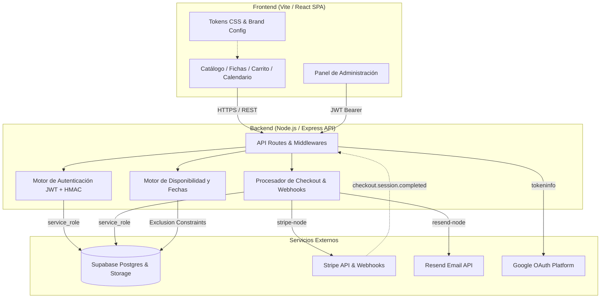
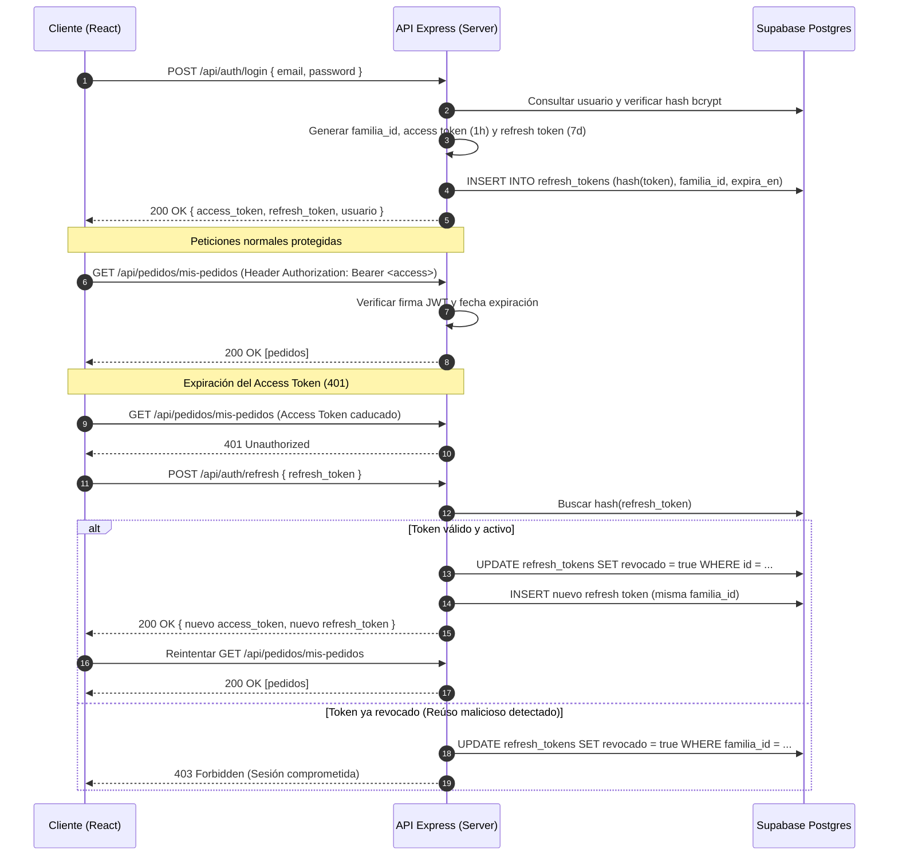
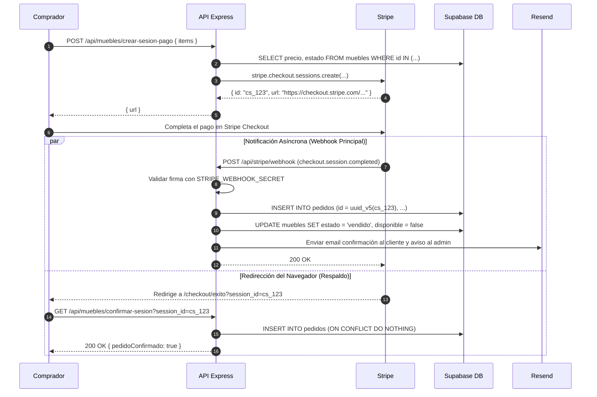
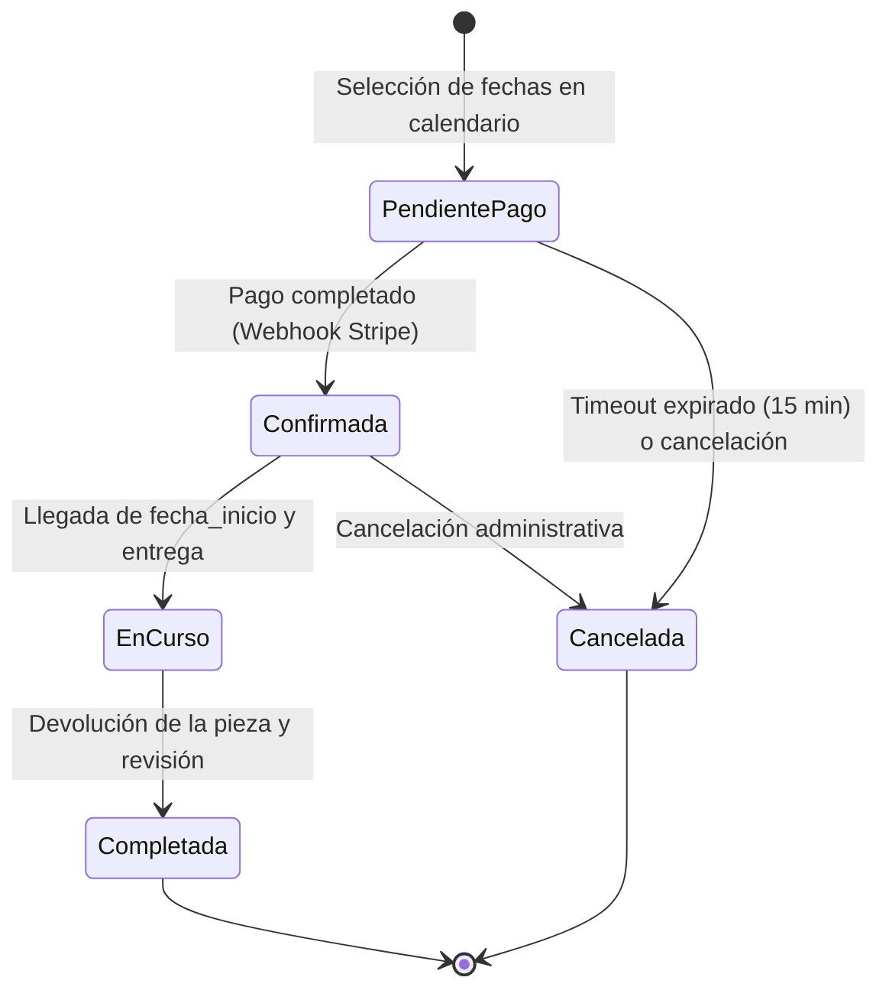

# Arquitectura Técnica del Sistema (ARCHITECTURE.md)

Documentación exhaustiva de arquitectura, flujos de datos, protocolos de seguridad y decisiones de diseño para la plataforma de catálogo, e-commerce y alquiler de mobiliario.

---

## Tabla de Contenidos (TOC)

1. [Visión General del Sistema](#1-visión-general-del-sistema)
2. [Estructura del Repositorio y Componentes](#2-estructura-del-repositorio-y-componentes)
   - [2.1 Directorio `client/` (Frontend React)](#21-directorio-client-frontend-react)
   - [2.2 Directorio `server/` (Backend Express & API)](#22-directorio-server-backend-express--api)
   - [2.3 Directorio `docs/` (Conocimiento y Especificaciones)](#23-directorio-docs-conocimiento-y-especificaciones)
3. [Flujo de Autenticación y Seguridad (JWT + Refresh Rotation)](#3-flujo-de-autenticación-y-seguridad-jwt--refresh-rotation)
   - [3.1 Ciclo de Vida de los Tokens](#31-ciclo-de-vida-de-los-tokens)
   - [3.2 Detección de Reúso y Revocación de Familia](#32-detección-de-reúso-y-revocación-de-familia)
   - [3.3 Diagrama de Secuencia de Autenticación](#33-diagrama-de-secuencia-de-autenticación)
4. [Flujo de Venta E-commerce (Checkout & Webhooks)](#4-flujo-de-venta-e-commerce-checkout--webhooks)
   - [4.1 Validación de Disponibilidad y Creación de Sesión](#41-validación-de-disponibilidad-y-creación-de-sesión)
   - [4.2 Idempotencia Determinista (UUID v5)](#42-idempotencia-determinista-uuid-v5)
   - [4.3 Diagrama de Secuencia de Compra](#43-diagrama-de-secuencia-de-compra)
5. [Flujo de Alquiler y Reservas por Calendario](#5-flujo-de-alquiler-y-reservas-por-calendario)
   - [5.1 Selección de Fechas y Concurrencia (GiST / Exclusion Constraints)](#51-selección-de-fechas-y-concurrencia-gist--exclusion-constraints)
   - [5.2 Estados de una Reserva](#52-estados-de-una-reserva)
   - [5.3 Diagrama de Estados y Flujo de Alquiler](#53-diagrama-de-estados-y-flujo-de-alquiler)
6. [Estructura Modular, Feature Flags y Sistema de Temas](#6-estructura-modular-feature-flags-y-sistema-de-temas)
   - [6.1 Dónde Vive Cada Cosa](#61-dónde-vive-cada-cosa)
   - [6.2 Sistema de Design Tokens (`tokens.css`)](#62-sistema-de-design-tokens-tokenscss)
   - [6.3 Configuración de Marca Centralizada (`brand.config.js`)](#63-configuración-de-marca-centralizada-brandconfigjs)
7. [Decisiones de Diseño Clave y Racionales](#7-decisiones-de-diseño-clave-y-racionales)

---

## 1. Visión General del Sistema

La arquitectura está construida sobre un modelo cliente-servidor desacoplado con separación estricta de responsabilidades:



**Principios de Seguridad y Aislamiento:**
- El cliente (navegador) **nunca** se comunica directamente con Supabase, Stripe o Resend.
- El servidor Node.js es el único custodio de las claves secretas (`SUPABASE_SERVICE_ROLE_KEY`, `STRIPE_SECRET_KEY`, `RESEND_API_KEY`).
- Todas las entradas procedentes de usuarios o clientes se validan estrictamente mediante esquemas Zod antes de acceder a la base de datos o ejecutar lógica de negocio.

---

## 2. Estructura del Repositorio y Componentes

### 2.1 Directorio `client/` (Frontend React)
- **`src/pages/`**: Vistas principales accesibles por rutas (`Home.jsx`, `Catalogo.jsx`, `ProductDetail.jsx`, `Reservas.jsx`, `CheckoutResultado.jsx`, `Profile.jsx`).
- **`src/pages/admin/`**: Panel de gestión para inventario, pedidos, calendario de reservas, mensajes de clientes y registros de auditoría.
- **`src/components/`**: Componentes reutilizables de UI (tarjetas de producto, modales de autenticación, banner de cookies, calendarios).
- **`src/theme/`**:
  - `tokens.css`: Especificación canónica de variables CSS (colores, fuentes, sombras, radios, espaciados).
  - `brand.config.js`: Metadatos y configuración comercial de la marca.
  - `theme-cliente-demo.css`: Tema de ejemplo alternativo documentado.
- **`src/utils/`**: Clientes de API, helpers de formato de moneda/fechas, sanitización SEO y metadatos dinámicos.

### 2.2 Directorio `server/` (Backend Express & API)
- **`src/routes/`**: Controladores de endpoints REST agrupados funcionalmente (`auth.routes.js`, `muebles.routes.js`, `pedidos.routes.js`, `reservas.routes.js`, `stripe.routes.js`, `contacto.routes.js`).
- **`src/middleware/`**: Autenticación (`verificarToken`, `verificarAdmin`), rate limiting, validación Zod, CSP y CORS.
- **`src/data/`**: Capa de acceso a datos con cliente `supabase.js` configurado con privilegios `service_role`.
- **`src/utils/`**: Helpers criptográficos (`tokens.js`, `hash.js`), emails (`email.js`), pagos e idempotencia (`pagos.js`).
- **`migrations/`**: Historial cronológico de scripts SQL aplicados en la base de datos Supabase con archivos `.down.sql` de reversión.
- **`scripts/`**: Scripts de utilidad técnica como `generarSecretos.js` y optimización de imágenes.

### 2.3 Directorio `docs/` (Conocimiento y Especificaciones)
- `DEPLOY.md`: Guía de puesta en producción paso a paso.
- `ENV_VARS.md`: Diccionario de variables de entorno frontend y backend.
- `NUEVO_CLIENTE.md`: Checklist de despliegue para nuevas marcas en 30 minutos.
- `ARCHITECTURE.md`: Este documento de arquitectura.

---

## 3. Flujo de Autenticación y Seguridad (JWT + Refresh Rotation)

El sistema de autenticación implementa un esquema de doble token con detección de reúso de refresh tokens:

### 3.1 Ciclo de Vida de los Tokens
1. **Access Token**:
   - Formato: JWT firmado con `JWT_SECRET`.
   - Duración: **1 hora**.
   - Almacenamiento: **En memoria** de la aplicación cliente (evita ataques XSS directos sobre almacenamiento persistente).
2. **Refresh Token**:
   - Formato: Cadena aleatoria de 64 bytes criptográficos.
   - Duración: **7 días**.
   - Almacenamiento en Cliente: `localStorage`.
   - Almacenamiento en Servidor: Se almacena **únicamente su digest HMAC-SHA256** derivado con `REFRESH_TOKEN_HASH_SECRET`. Si la base de datos se viera comprometida, los refresh tokens reales no son deducibles.

### 3.2 Detección de Reúso y Revocación de Familia
- Cada refresh token pertenece a una `familia_id`.
- Cuando el cliente solicita un nuevo par de tokens (`POST /api/auth/refresh`), el refresh token actual se revoca inmediatamente y se emite uno nuevo (rotación).
- Si un atacante o cliente intenta presentar un refresh token que ya fue consumido fuera de la ventana de gracia de 60 segundos:
  - El servidor detecta la anomalía como un posible robo de sesión.
  - **Revoca inmediatamente todos los tokens asociados a esa `familia_id`**, cerrando todas las sesiones derivadas de ese login.

### 3.3 Diagrama de Secuencia de Autenticación



---

## 4. Flujo de Venta E-commerce (Checkout & Webhooks)

### 4.1 Validación de Disponibilidad y Creación de Sesión
El cliente solicita la compra enviando los identificadores de su carrito. El backend valida en base de datos:
- Que cada mueble existe y su estado es `'disponible'`.
- Que el precio unitario corresponde al precio real de catálogo (impidiendo manipulaciones en cliente).
- Crea una sesión de Stripe Checkout bloqueando temporalmente o asociando metadatos.

### 4.2 Idempotencia Determinista (UUID v5)
Para prevenir la duplicación de pedidos ante reintentos de red o carreras entre el webhook y la redirección del navegador:
- El identificador del pedido se calcula mediante un **UUID v5 determinista** basado en el `cs_...` (Session ID de Stripe).
- Tanto `POST /api/stripe/webhook` como `GET /api/muebles/confirmar-sesion` intentan insertar el pedido con ese identificador.
- El primero en completarse escribe la fila y actualiza el estado del mueble a `'vendido'`.
- El segundo recibe una violación de clave única en Postgres (`23505 duplicate key`) y la trata como éxito idempotente, devolviendo el pedido ya creado.

### 4.3 Diagrama de Secuencia de Compra



---

## 5. Flujo de Alquiler y Reservas por Calendario

El módulo de reservas permite el alquiler temporal de piezas de mobiliario por intervalos de fechas.

### 5.1 Concurrencia y Restricciones de Exclusión (GiST)
Para garantizar que una pieza **nunca sea reservada por dos clientes en fechas solapadas**, la base de datos utiliza la extensión PostgreSQL `btree_gist` con una restricción de exclusión estricta:

```sql
ALTER TABLE reservas ADD CONSTRAINT reservas_sin_solapamiento
EXCLUDE USING gist (
  mueble_id WITH =,
  daterange(fecha_inicio, fecha_fin, '[]') WITH &&
) WHERE (estado IN ('confirmada', 'en_curso', 'pendiente_pago'));
```

Cualquier transacción concurrente que intente reservar días coincidentes es rechazada automáticamente por el motor relacional a nivel ACID.

### 5.2 Estados de una Reserva
1. `pendiente_pago`: Reserva temporal iniciada mientras el usuario completa la fianza o pago.
2. `confirmada`: Pago verificado, fechas bloqueadas en el calendario.
3. `en_curso`: Pieza entregada al cliente durante el intervalo de alquiler.
4. `completada`: Pieza devuelta, inspeccionada y fianza liquidada.
5. `cancelada`: Reserva anulada antes del inicio del periodo.

### 5.3 Diagrama de Estados y Flujo de Alquiler



---

## 6. Estructura Modular, Feature Flags y Sistema de Temas

### 6.1 Dónde Vive Cada Cosa

| Dominio | Frontend (`client/`) | Backend (`server/`) | Base de Datos |
|---|---|---|---|
| **Catálogo y Fichas** | `src/pages/Catalogo.jsx`, `src/pages/ProductDetail.jsx` | `src/routes/muebles.routes.js` | Tabla `muebles`, `categorias` |
| **Venta E-commerce** | `src/components/CarritoModal.jsx`, `src/pages/Checkout*.jsx` | `src/routes/stripe.routes.js`, `src/utils/pagos.js` | Tabla `pedidos` |
| **Reservas / Alquiler**| `src/pages/Reservas.jsx`, `src/components/reservas/` | `src/routes/reservas.routes.js` | Tabla `reservas` (btree_gist) |
| **Administración** | `src/pages/admin/` (`AdminLayout.jsx`, `pestanas/`) | `src/middleware/auth.js` (`verificarAdmin`) | Columna `usuarios.rol = 'admin'` |
| **Diseño / Marca** | `src/theme/tokens.css`, `src/theme/brand.config.js` | Parámetros de email en `src/utils/email.js` | N/A |

### 6.2 Sistema de Design Tokens (`tokens.css`)
Centraliza todos los valores estilísticos de la interfaz:
- Variables semánticas primarias: `--color-primary`, `--color-accent`, `--color-surface`, `--color-text`.
- Variables de tipografía: `--font-display` (titulares), `--font-body` (interfaz), `--font-mono` (códigos/SKUs).
- Variables de espaciado, sombras y radios: `--space-*`, `--shadow-*`, `--radius-*`.
- **Compatibilidad**: Mantiene alias heredados (`--accent-color`, `--primary-color`) para garantizar que componentes existentes sigan funcionando sin regresiones.

### 6.3 Configuración de Marca Centralizada (`brand.config.js`)
Permite reconfigurar el nombre de la tienda, prefijo SKU de inventario, moneda, canales de contacto y activar o desactivar módulos enteros (`modulos.ecommerce`, `modulos.bookings`) modificando un único archivo.

---

## 7. Decisiones de Diseño Clave y Racionales

| Decisión Arquitectónica | Razón Técnica / Justificación | Beneficio Directo |
|---|---|---|
| **`service_role` en Backend en vez de `anon`** | El servidor implementa validación exhaustiva con Zod y control de roles propio. Eludir RLS en servidor previene bugs silenciosos donde el cliente Postgres recibía conjuntos vacíos por políticas RLS pensadas para el navegador. | Fiabilidad total en consultas de backend y simplificación de reglas. |
| **Idempotencia con UUID v5** | Conexiones móviles inestables o webhooks duplicados de Stripe podrían crear pedidos dobles. Derivar el ID del pedido a partir del `session_id` garantiza unicidad a nivel de esquema en base de datos. | Imposibilidad matemática de cobrar o registrar un pedido por duplicado. |
| **Exclusion Constraints (`btree_gist`) para Reservas** | El bloqueo a nivel de aplicación (comprobar disponibilidad y luego insertar) tiene ventanas de condición de carrera (*race conditions*). Postgres resuelve la concurrencia a nivel de motor de almacenamiento. | Cero *overbooking* o dobles reservas bajo alta concurrencia. |
| **Doble Token JWT + Refresh con HMAC** | Minimiza la exposición ante ataques XSS al almacenar el token de corta duración solo en memoria, a la vez que ofrece UX fluida sin desloguear al usuario cada hora. | Máxima seguridad para sesiones de administración y clientes. |
| **Tokens CSS con alias retrocompatibles** | Extraer variables CSS a una capa limpia sin romper estilos ni tests de componentes históricos. | Mantenibilidad a largo plazo y facilidad para crear marcas blancas o temas para nuevos clientes. |
